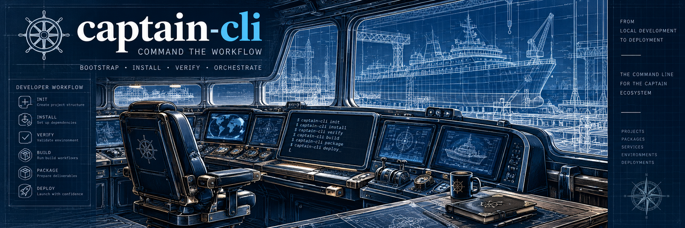

# Captain CLI
<p align="center">
  
</p>
`captain-cli` is the user-facing entry point for the Captain ecosystem.

It owns terminal concerns and host bootstrap/lifecycle UX: command parsing, help text,
project selection, exit behavior, host inspection, local CLI installation/verification,
and presentation. The `captain` package remains the orchestration engine and owns the
project/build/package/publish workflows that the CLI invokes.

```text
fresh host / terminal
        |
        v
   captain-cli
        |
        +-- bootstrap doctor/install/verify
        |
        v
     Captain
        |
        +-- Outfit
        +-- Stager
        +-- Embark
        +-- Publish providers
```

Bootstrap functionality is built directly into Captain CLI.
There is no separate bootstrap executable:
the installed command remains `captain`.
## Development

Install Captain and the CLI side-by-side, then build:

```bash
npm install
npm run check
npm test
```

Normal project commands remain unchanged:

```bash
captain --help
captain build check
captain package plan
```

Host bootstrap/lifecycle commands live under `bootstrap` so they do not collide with
Captain's existing ecosystem-tool `install` command:

```bash
captain bootstrap doctor
captain bootstrap install --source /path/to/captain
captain bootstrap verify
```
